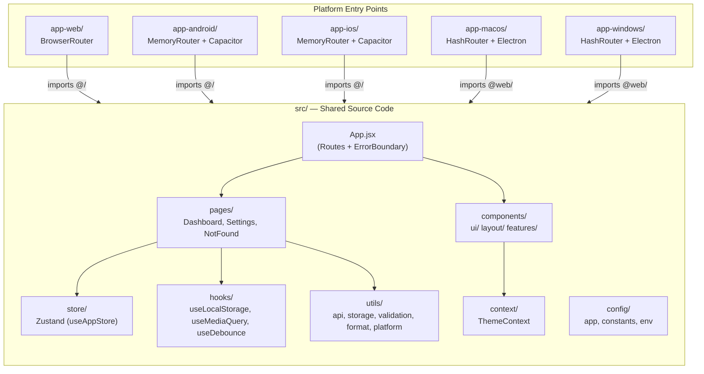
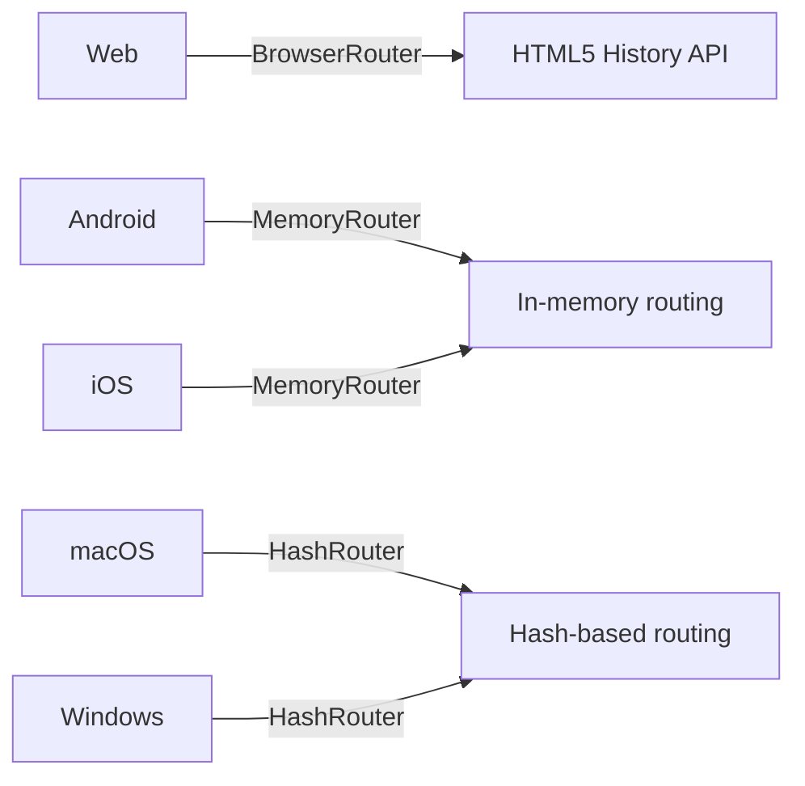
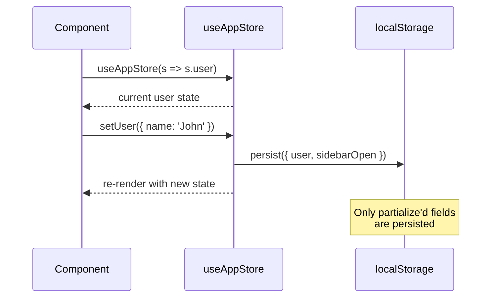

# App Development Guide

> This guide travels with every app created from the template.
> It covers architecture, conventions, and how to use the built-in components, hooks, and utilities.

## Table of Contents

- [Architecture Overview](#architecture-overview)
- [Getting Started](#getting-started)
- [Project Structure](#project-structure)
- [Configuration](#configuration)
- [Routing](#routing)
- [State Management](#state-management)
- [Available Components](#available-components)
- [Available Hooks](#available-hooks)
- [Available Utilities](#available-utilities)
- [Platform-Specific Development](#platform-specific-development)
- [Code Quality](#code-quality)

---

## Architecture Overview



## Getting Started

### 1. Copy and Rename

```bash
cp -r app_folder my-new-app
cd my-new-app
```

### 2. Update Configuration

Edit `app.config.json`:
```json
{
  "app": {
    "name": "MyNewApp",
    "displayName": "My New Application",
    "description": "Description of your app"
  },
  "identifiers": {
    "bundleId": "com.yourcompany.mynewapp"
  }
}
```

### 3. Install and Run

```bash
npm install
npm run web:setup
npm run web:dev
```

### 4. Start Building

- Add pages in `src/pages/`
- Add feature components in `src/components/features/`
- Add routes in `src/App.jsx`
- Add state slices in `src/store/useAppStore.js`

## Project Structure

```
{app-root}/
├── app.config.json          # App configuration (name, version, identifiers)
├── build.py                 # Unified build script
├── package.json             # Shared dependencies
├── eslint.config.js         # ESLint configuration
├── .prettierrc              # Prettier formatting rules
├── .clinerules              # AI coding conventions
│
├── src/                     # SHARED SOURCE — all platforms import from here
│   ├── App.jsx              # Main app (routes, error boundary)
│   ├── main.jsx             # Web entry point
│   ├── index.css            # Base styles & theme variables
│   │
│   ├── components/
│   │   ├── features/        # App-specific feature components
│   │   ├── layout/          # Layout shells (AppLayout, ErrorBoundary)
│   │   └── ui/              # Reusable UI (Button, Modal, Toast, Loading)
│   │
│   ├── pages/               # Route pages (Dashboard, Settings, NotFound)
│   ├── store/               # Zustand state stores
│   ├── hooks/               # Custom React hooks
│   ├── context/             # React contexts (ThemeContext)
│   ├── config/              # App config, constants, env helpers
│   ├── utils/               # Utility functions
│   ├── extensions/          # App extensions (plugins, etc.)
│   └── assets/              # Static assets (icons, images)
│
├── public/                  # Shared public assets (favicon, logos)
├── docs/                    # This documentation
│
├── app-web/                 # Web platform wrapper
├── app-android/             # Android (Capacitor)
├── app-ios/                 # iOS (Capacitor)
├── app-macos/               # macOS (Electron)
└── app-windows/             # Windows (Electron)
```

## Configuration

### app.config.json

Central configuration file read by all platform build configs:

| Section | Purpose |
|---------|---------|
| `app` | Name, version, description, author |
| `developer` | Developer info shown in Settings/About |
| `identifiers` | Bundle IDs for each platform |
| `platforms` | Enable/disable platforms, set ports |
| `build` | Shared assets, Java home paths |
| `environment` | List of expected env variables |
| `features` | Feature flags (googleAuth, cloudSync, etc.) |

### Environment Variables

Create `.env` files in each platform directory (see `.env.example`):

```env
VITE_API_BASE_URL=https://api.example.com
VITE_GOOGLE_CLIENT_ID=your-client-id
VITE_GEMINI_API_KEY=your-api-key
```

Access in code:
```javascript
import env from '@/config/env';
console.log(env.apiBaseUrl);
console.log(env.isDev);
```

## Routing

### Router Selection by Platform



| Platform | Router | Reason |
|----------|--------|--------|
| Web | `BrowserRouter` | Standard browser history API |
| Android/iOS | `MemoryRouter` | Capacitor WebView doesn't support History API |
| macOS/Windows | `HashRouter` | Electron uses `file://` protocol in production |

### Adding Routes

Edit `src/App.jsx`:
```jsx
import MyNewPage from './pages/MyNewPage';

// Inside <Routes>:
<Route path="/my-page" element={<MyNewPage />} />
```

Update `src/config/constants.js`:
```javascript
export const ROUTES = {
  HOME: '/',
  DASHBOARD: '/dashboard',
  MY_PAGE: '/my-page',    // Add here
  SETTINGS: '/settings',
};
```

## State Management

### Zustand Store

The app uses [Zustand](https://github.com/pmndrs/zustand) for state management with localStorage persistence.



**Usage:**
```javascript
import { useAppStore } from '@/store/useAppStore';

function MyComponent() {
  // Select specific state (recommended — avoids unnecessary re-renders)
  const user = useAppStore((state) => state.user);
  const setUser = useAppStore((state) => state.setUser);

  // Or destructure multiple values
  const { isLoading, setLoading } = useAppStore();
}
```

**Adding new state:**
```javascript
// In store/useAppStore.js, add to the create() callback:
todos: [],
addTodo: (todo) => set((state) => ({
  todos: [...state.todos, { id: Date.now(), ...todo }],
})),
```

## Available Components

### Button
```jsx
import { Button } from '@/components/ui';

<Button variant="primary" onClick={handleSave}>Save</Button>
<Button variant="danger" size="sm" loading={isSaving}>Delete</Button>
<Button variant="ghost">Cancel</Button>
<Button variant="secondary" size="lg" disabled>Disabled</Button>
```

| Prop | Type | Default | Options |
|------|------|---------|---------|
| `variant` | string | `'primary'` | `'primary'`, `'secondary'`, `'danger'`, `'ghost'` |
| `size` | string | `'md'` | `'sm'`, `'md'`, `'lg'` |
| `loading` | boolean | `false` | Shows spinner, disables button |
| `disabled` | boolean | `false` | Disables button |

### Modal
```jsx
import { Modal } from '@/components/ui';

<Modal
  isOpen={showModal}
  onClose={() => setShowModal(false)}
  title="Confirm Action"
  size="md"
  footer={
    <>
      <Button variant="secondary" onClick={() => setShowModal(false)}>Cancel</Button>
      <Button onClick={handleConfirm}>Confirm</Button>
    </>
  }
>
  <p>Are you sure you want to proceed?</p>
</Modal>
```

| Prop | Type | Default | Options |
|------|------|---------|---------|
| `isOpen` | boolean | — | Required |
| `onClose` | function | — | Required |
| `title` | string | — | Modal header |
| `size` | string | `'md'` | `'sm'`, `'md'`, `'lg'`, `'xl'` |
| `footer` | ReactNode | — | Optional footer content |

### Toast
```jsx
import { ToastProvider, useToast } from '@/components/ui';

// Wrap app (once):
<ToastProvider><App /></ToastProvider>

// In any component:
const { addToast } = useToast();
addToast({ type: 'success', message: 'Saved!' });
addToast({ type: 'error', message: 'Failed to save', duration: 5000 });
```

| Type | Icon | Color |
|------|------|-------|
| `'success'` | ✓ | Green |
| `'error'` | ✕ | Red |
| `'warning'` | ⚠ | Yellow |
| `'info'` | ℹ | Blue |

### Loading
```jsx
import { Loading } from '@/components/ui';

<Loading />
<Loading message="Loading data..." fullPage />
<Loading size="sm" />
```

### ErrorBoundary
```jsx
import ErrorBoundary from '@/components/layout/ErrorBoundary';

<ErrorBoundary>
  <RiskyComponent />
</ErrorBoundary>

<ErrorBoundary fallback={<CustomErrorUI />}>
  <AnotherComponent />
</ErrorBoundary>
```

### AppLayout
```jsx
import AppLayout from '@/components/layout/AppLayout';

// In App.jsx routes:
<Route element={<AppLayout />}>
  <Route path="/dashboard" element={<Dashboard />} />
  <Route path="/settings" element={<Settings />} />
</Route>
```

## Available Hooks

### useLocalStorage
```javascript
import { useLocalStorage } from '@/hooks/useLocalStorage';

const [name, setName] = useLocalStorage('user-name', 'Guest');
const [prefs, setPrefs] = useLocalStorage('prefs', { fontSize: 14 });
```

### useMediaQuery
```javascript
import { useMediaQuery } from '@/hooks/useMediaQuery';

const isMobile = useMediaQuery('(max-width: 640px)');
const isDark = useMediaQuery('(prefers-color-scheme: dark)');
```

### useDebounce
```javascript
import { useDebounce } from '@/hooks/useDebounce';

const [search, setSearch] = useState('');
const debouncedSearch = useDebounce(search, 300);

useEffect(() => {
  fetchResults(debouncedSearch);
}, [debouncedSearch]);
```

## Available Utilities

### API Client (`utils/api.js`)
```javascript
import api from '@/utils/api';

const users = await api.get('/users');
const user = await api.post('/users', { name: 'John' });
await api.put('/users/1', { name: 'Jane' });
await api.delete('/users/1');

// With query params
const results = await api.get('/search', { params: { q: 'term' } });

// Error handling
try {
  await api.post('/data', payload);
} catch (error) {
  if (error instanceof ApiError) {
    console.log(error.status, error.message);
  }
}
```

### Storage (`utils/storage.js`)
```javascript
import storage from '@/utils/storage';

storage.set('user', { name: 'John' });
const user = storage.get('user');
const missing = storage.get('key', 'default');
storage.has('user');    // true
storage.remove('user');
storage.keys();         // ['user', ...]
storage.clear();        // Clears only app-namespaced keys
```

### Validation (`utils/validation.js`)
```javascript
import { validateEmail, validateRequired, validateMinLength, validate } from '@/utils/validation';

const result = validateEmail('user@example.com');
// { valid: true }

const result = validateEmail('invalid');
// { valid: false, message: 'Please enter a valid email address' }

// Compose validators
const result = validate(value, [
  (v) => validateRequired(v, 'Name'),
  (v) => validateMinLength(v, 3, 'Name'),
]);
```

### Formatting (`utils/format.js`)
```javascript
import { formatDate, formatNumber, formatCurrency, formatFileSize, truncate } from '@/utils/format';

formatDate(new Date());              // 'Oct 11, 2025'
formatDate(new Date(), 'relative');  // '2 hours ago'
formatNumber(1234567);               // '1,234,567'
formatCurrency(29.99);               // '$29.99'
formatFileSize(1048576);             // '1.0 MB'
truncate('Long text here', 10);      // 'Long te...'
```

### Platform Detection (`utils/platform.js`)
```javascript
import { getPlatform, isMobile, isDesktop, isWeb } from '@/utils/platform';

getPlatform();  // 'web' | 'android' | 'ios' | 'desktop'
isMobile();     // true on Android/iOS
isDesktop();    // true on Electron
isWeb();        // true in browser
```

## Platform-Specific Development

### Web
```bash
npm run web:setup    # Install dependencies
npm run web:dev      # Start dev server (port 5173)
npm run web:build    # Production build
```

### Android
```bash
npm run android:setup   # Install deps + init Capacitor
npm run android:run     # Build + open in Android Studio
npm run android:apk     # Build APK
```

### iOS
```bash
npm run ios:setup    # Install deps + init Capacitor
npm run ios:run      # Build + open in Xcode
```

### macOS
```bash
npm run mac:setup    # Install deps
npm run mac:dev      # Start Electron dev
npm run mac:dmg      # Build DMG installer
```

### Windows
```bash
npm run win:setup    # Install deps
npm run win:dev      # Start Electron dev
npm run win:nsis     # Build NSIS installer
```

## Code Quality

### Linting
```bash
npm run lint         # Check for issues
npm run lint:fix     # Auto-fix issues
```

### Formatting
```bash
npm run format       # Format all source files
npm run format:check # Check formatting without changing
```

### Conventions
- See `.clinerules` for AI coding conventions
- React components use PascalCase
- Hooks use `use` prefix
- Utilities use camelCase
- Constants use UPPER_SNAKE_CASE
